# SEMIS configuration manual { #semis_configuration }

This manual guides system administrators and implementers through installing the SEMIS web app, preparing access, configuring the school calendar, and mapping student and staff modules to DHIS2 Tracker metadata.

Complete the prerequisites first. Configure the calendar and core registration mappings before testing attendance, performance, transfers, and academic or staff outcomes.

## Document control { #semis_config_document_control }

| Item | Record |
| :---- | :---- |
| SEMIS release | 2.1 |
| Document revision | 16 October 2026 |
| Intended readers | System administrators and implementation specialists |
| DHIS2 compatibility | 2.43 version and 3 versions below. |

## About this manual { #semis_config_about_this_manual }

Configuration selects which existing DHIS2 objects the SEMIS screens use. Prepare the Tracker programs and their metadata in DHIS2 before mapping them in SEMIS. Values displayed in screenshots illustrate a configuration screen; select the objects used by your implementation.

| Term | Meaning in this manual |
| :---- | :---- |
| Tracked entity | The individual student or staff record. |
| Enrollment | A tracked entity’s participation in a Tracker program. |
| Program stage and event | A stage defines a data collection step; an event records its data. |
| Mapping | A SEMIS setting that references a program, stage, attribute, data element, or option. |
| Option name and code | The displayed label and stored code may differ. Verify the mapped option and its code. |
| School | A school represented by an organisation unit in DHIS2. |

> **Note** :
> An asterisk in the app marks a required field. Complete every required field, including those below the visible part of a scrollable form.

The SEMIS application provides functionality for managing student and staff information within DHIS2 using tracker-based programs. In addition to operational data entry, the application includes built-in configuration options that allow administrators to manage system settings and metadata.

Unlike systems that use a separate configuration application, SEMIS integrates configuration directly within the **SEMIS App interface**. Administrators can access configuration features by selecting the **Configuration option** within the SEMIS application.

This integrated design ensures that system administrators can configure the system while remaining within the same application environment used for operational workflows.

The SEMIS configuration interface allows administrators to:

* Activate or deactivate functional modules
* Configure program stages and metadata
* Map option sets and data elements
* Manage system settings related to the Academic year and School Calendar

## Install the SEMIS app { #semis_config_install_the_semis_app }

1. **Check compatibility before downloading.** Read the release notes and confirm that the SEMIS release supports your DHIS2 version.
2. **Download the application package.** Open the [SEMIS releases page](https://github.com/Saudigitus/dhis2-semis-core/releases), find the required release, expand **Assets**, and select SEMIS app. Keep the file zipped. The **Source code (zip)** and **Source code (tar.gz)** files are development archives, so use the named SEMIS application package.
3. **Log in to your DHIS2 instance** Use an administrator account with permission to install and manage applications.
4. **Upload the ZIP file** Open **App Menu >  App Management > Manual Install**. Select or upload the downloaded SEMIS ZIP file and wait for the installation to complete. DHIS2 supports manual installation of packaged web apps through this screen.
5. **Open SEMIS** Refresh the page, open the **App Menu**, search for **SEMIS**, and select it. You can also open an installed application from its details page in App Management. [DHIS2 Documentation](https://docs.dhis2.org/en/use/user-guides/dhis-core-version-243/maintaining-the-system/installing-applications.html).
6. **Complete the SEMIS setup** Installing the web app is one part of implementation. Before data entry, check that your instance has:

   * The required Student and/or Staff Tracker metadata.
   * Programs assigned to the appropriate school organisation units.
   * SEMIS configuration linking the modules to the correct programs, stages, attributes, and data elements.
   * School calendar settings where required.
   * User roles, program sharing, and school access configured.

7. **Verify the installation** On a test instance, confirm that SEMIS opens, the intended schools and modules appear, and an authorised user can register a test student and save an attendance record.

## User roles and access requirements { #semis_config_user_roles_and_access_requirements }

Access to the SEMIS APP Configuration tab is typically restricted to users with **administrative privileges**.

| User Roles | Responsibility | User/authority |
| :---- | :---- | :---- |
| System Administrator | Configure metadata, programs, and module activation | Superuser |
| Implementation Specialist | Configure tracker workflows and data structures | Program Manager |
| Data Entry | Verify the users can access the correct schools | Data Entry Operator |

The configuration user needs access to SEMIS and the referenced metadata, together with permission to save SEMIS settings. Metadata editing and app installation require the corresponding DHIS2 authorities. Validate access using the actual implementation roles.

## Access SEMIS configuration { #semis_config_access_semis_configuration }

To configure SEMIS settings, administrators must access the configuration section within the SEMIS application.

> **Note** :
> Configure the student and staff Tracker programs in DHIS2 before mapping them in SEMIS.

### Open configuration { #semis_config_open_configuration }

1. Log into **DHIS2** using administrator credentials.
2. Open the **App Menu** from the DHIS2 navigation bar.
3. Select the **SEMIS App**.

   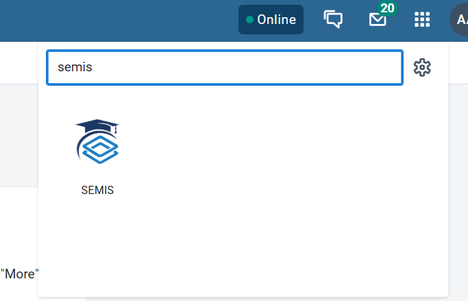

4. Within the SEMIS interface, on the right side panel, you have the  **Configuration** option.
5. Under Configuration, you have two options:

   * School Calendar
   * Configurations

The configuration interface displays all available modules grouped under:

* **Student Modules**
* **Staff Modules**

Each module can be activated and configured according to system requirements.

### Recommended configuration sequence { #semis_config_recommended_configuration_sequence }

1. Configure school calendar
2. Configure student module screens
3. Configure staff module screens
4. Validate the workflows such as Enrolment, Attendance, Final Result, and Transfer Flows.

## Activate modules { #semis_config_activate_modules }

The SEMIS configuration interface includes toggle switches that allow administrators to enable or disable specific modules. Enrollment is required and cannot be deactivated.

**Toggle status:**

| Status | Meaning |
| :---- | :---- |
| Green  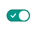 | Module is active and available for use |
| Grey      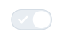 | Module is inactive and hidden from operational workflows |

Administrators should activate only the modules required for the current **education system implementation**.

**For example:**

* If student attendance is tracked digitally, the Student Attendance module should be activated.
* If socio-economic information is not collected, the Socio-economic module may remain inactive.

Activating a module enables:

* Data entry interfaces
* Program stage workflow.

## Configure the school calendar { #semis_config_configure_the_school_calendar }

The **School Calendar** allows administrators to define the structure of the academic year within SEMIS. It includes the configuration of academic years, school terms, school days, and non-school days.
Proper configuration ensures that modules such as **attendance tracking, academic reporting, and analytics** operate correctly based on the defined academic timeline.

Configure the calendar in this order:

1. Create the academic-year option.
2. Configure its dates and school days.
3. Add school terms.
4. Add non-school days.

### View existing academic years { #semis_config_view_existing_academic_years }

1. Open the **SEMIS App** in DHIS2.
2. Navigate to the **School Calendar section** within the configuration area.
3. The page displays a list of **existing academic years**.

The interface typically shows:

* Academic Year Name ( 2025)
* Academic Year Code  ( 2025)
* Start and End Date 2025-01-01 to 2025-12-31
* Actions (View Details, Edit, Delete)

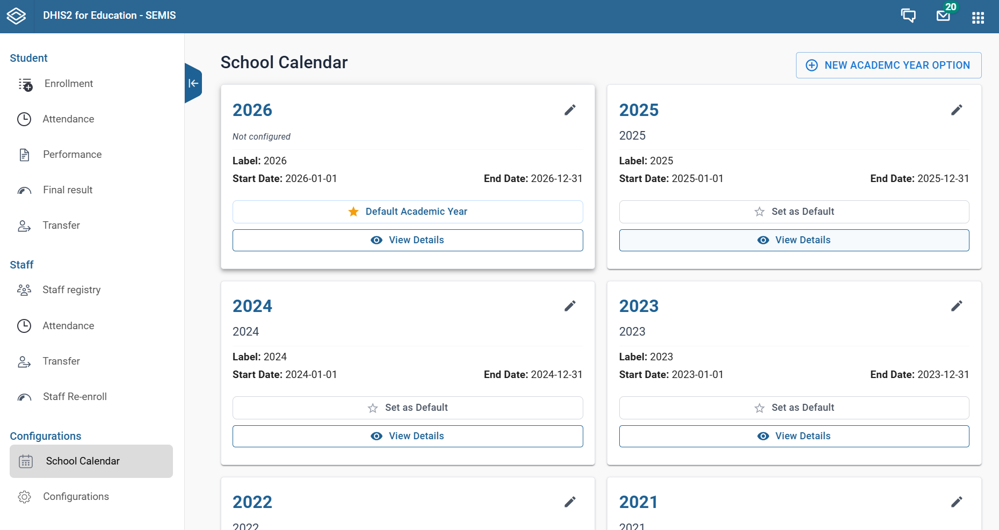

### Create an academic year { #semis_config_create_an_academic_year }

Administrators must create a new academic year before schools begin recording attendance or academic data.

1. Click **NEW ACADEMIC YEAR OPTION**.
2. A form will appear to enter academic year details.
3. Enter the following information.

   | Field  | Description |
   | :---- | :---- |
   | Name | Full name of the Academic Year ( e.g., Academic Year 2026 - 2027) Use a consistent naming format across academic years. |
   | Code | Short system code (e.g., AY2026) |
   | Start Date | Official start date of the academic year |
   | End Date | Official end date of the academic year |

4. Click Save
5. Once saved, the academic year will appear in the academic year list.

   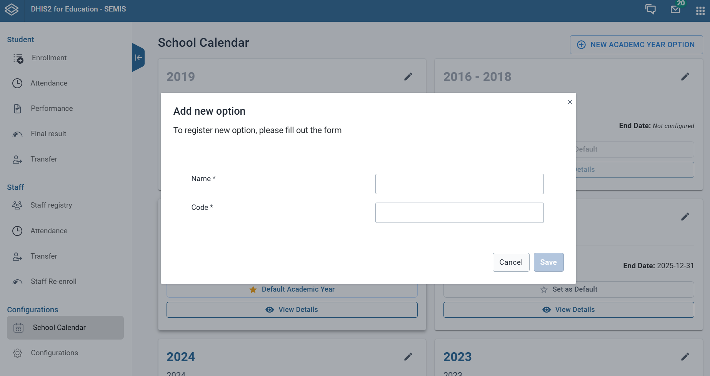

> **Caution** :
> If the current academic year does not align with the expected dates, review its configuration.

#### Configure general details and school days { #semis_config_configure_general_details_and_school_days }

After creating an academic year, administrators must configure the academic structure

1. Locate the Academic year from the list
2. Click View Details

The system opens the **Academic Year Configuration page**, where additional elements can be configured and school days can also be configured.

Configure regular school days:

1. Administrators can also define **regular school operational days**.
2. Click on General Details in the extreme left corner.
3. Select the regular school days, typically Monday to Friday.

If a school operates on weekends, these days can also be enabled.

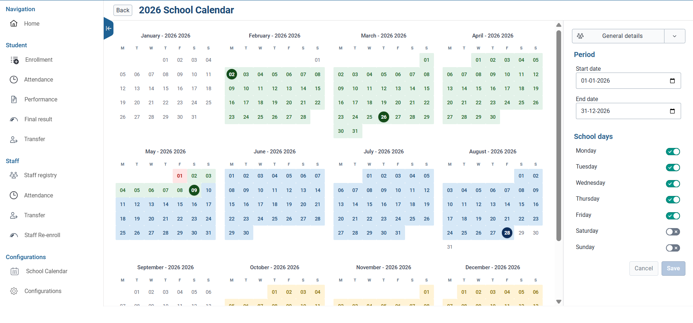

### Configure school terms { #semis_config_configure_school_terms }

School terms divide the academic year into teaching or assessment periods. Configure all terms used by the implementation before testing term-based workflows.

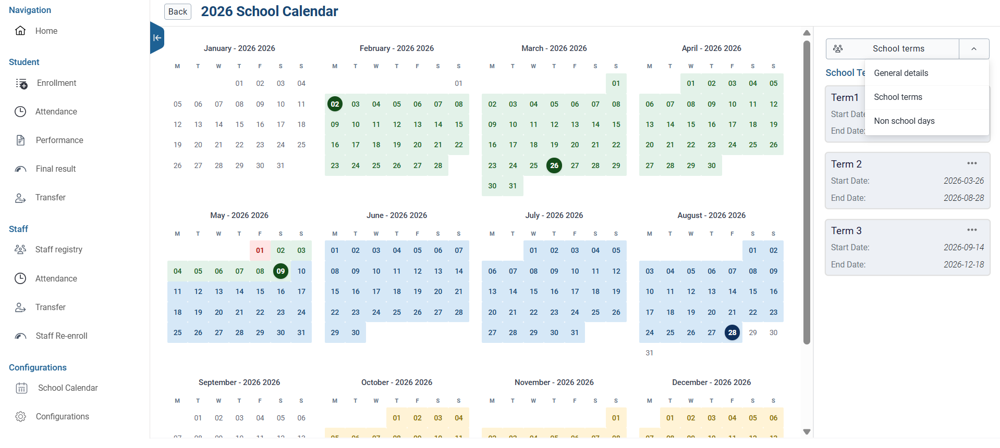

1. Click on the dropdown and select School terms
2. Click **+ icon to Add term**
3. Enter the following information:

   | Field  | Description |
   | :---- | :---- |
   | Description or Term name | Use a clear label,such as Term 1 |
   | Start Date | Enter the official first day of the term |
   | End Date | Enter the official last day of the term |

4. Save
5. Repeat for the remaining terms and review the complete list.

> **Important** :
> Terms must fall within the academic year dates and must not overlap. Include all required terms in each academic year.

### Configure non-school days { #semis_config_configure_non_school_days }

Record public holidays, special events, and school closures that interrupt the regular school-day schedule.

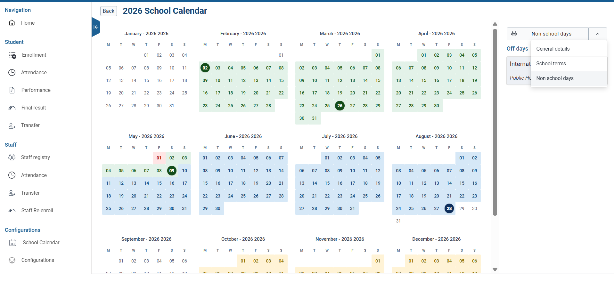

1. Select **Non-School Days** from the dropdown on the left.
2. Click **Non-school day**.
3. Enter the required details:

   | Field | Description |
   | :---- | :---- |
   | Date | Mention the Date |
   | Type | Reason for closure (Special event / Public Holiday) |
   | Event | Name the event |

4. Click **Save**.

These dates will automatically be excluded from attendance calculations.

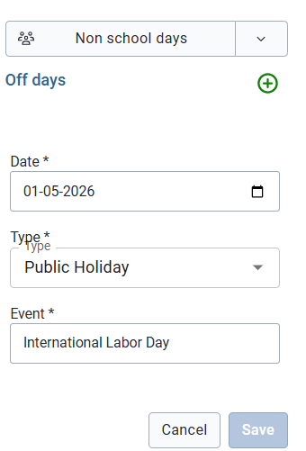

### Validate the school calendar { #semis_config_validate_the_school_calendar }

Before the school calendar is used by schools, administrators should verify the following:

* Academic Year Exists - Ensure the current academic year is created and active.
* Terms Are Correct.
* Terms do not overlap
* Terms fall within the academic year
* Holidays Are Configured - Verify that public holidays and school closures are correctly defined
* Operational Days Are Accurate - Ensure the configured school days reflect actual school schedules.
* Calendar Visibility - Ensure that the academic year is accessible to the intended schools and users.

## Configure student modules { #semis_config_configure_student_modules }

The **Student Configuration** section in the SEMIS application allows administrators to control how student-related modules function in the system. Through this configuration interface, administrators can enable or disable specific modules that support student management workflows.

This configuration helps ensure that only the required modules are available to schools based on their operational needs.

### Accessing student configuration { #semis_config_accessing_student_configuration }

To access the Student Configuration settings:

* Open the SEMIS application in DHIS2.
* Navigate to Configurations.
* Select Student.

This page displays a set of module icons representing different student-related processes that can be configured.

The primary goal of this section is to define and control student workflow behavior within the SEMIS system.

Administrators can use this configuration to:

* Enable or disable specific student management modules.
* Control which features are visible to users.
* Customize the system based on institutional requirements.

This helps streamline workflows and prevent users from accessing modules that are not required.

The Student Configuration interface includes several modules that support the student lifecycle.

### Enrollment { #semis_config_enrollment }

This module manages **student admission and enrollment into schools**. It allows users to register students and record their admission details and also socio-economic details.

* Specify Registration Details e.g Registration program Stage, Academic Year, Grade, Grade filter name, Registration program stage (DHIS2 tracker configured) etc., and Socio-Economic details
* Specify default configurations and submit.
* Fill in all mandatory fields, marked with \*

  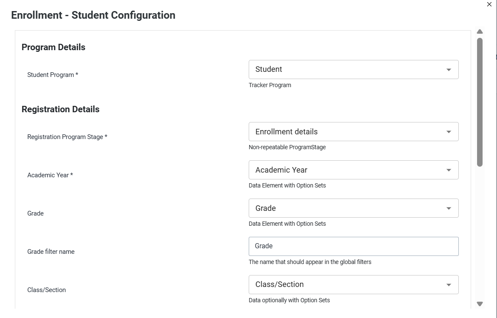

### Attendance { #semis_config_student_attendance }

The Attendance module enables schools to **record and manage student attendance**. Attendance tracking uses the configured school calendar and academic year.

1. Select and confirm the DHIS2 tracker configured for the student program.
2. Configure attendance status details and general details e.g., program stage, attendance status (Present, Absent)
3. Configure class attendance (Optional)

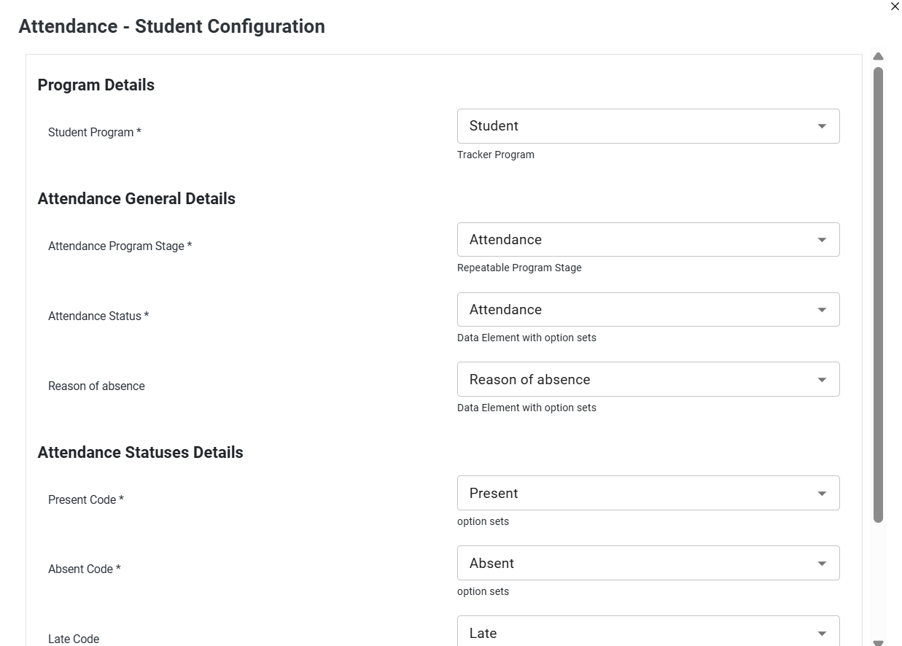

### Performance { #semis_config_performance }

The Performance module is used to **capture and manage students' academic performance,** including grades, assessments, and evaluation results.

1. Select and confirm the DHIS2 tracker configured for the student program
2. Select Performance program stages (DHIS2 Tracker configured)

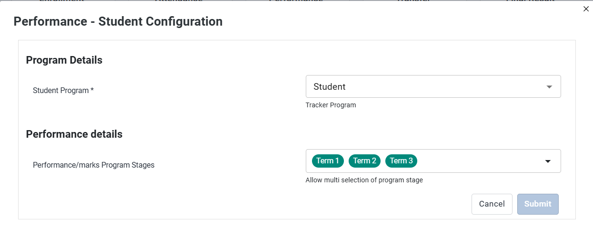

### Transfer { #semis_config_student_transfer }

This module allows administrators to **manage student transfers between schools** within the system.

1. Select and confirm the DHIS2 tracker configured for the student program.
2. Confirm transfer request fields/status mapping
3. Confirm incoming/outgoing list behavior tied to configured status
4. Confirm approval/rejection flow field.

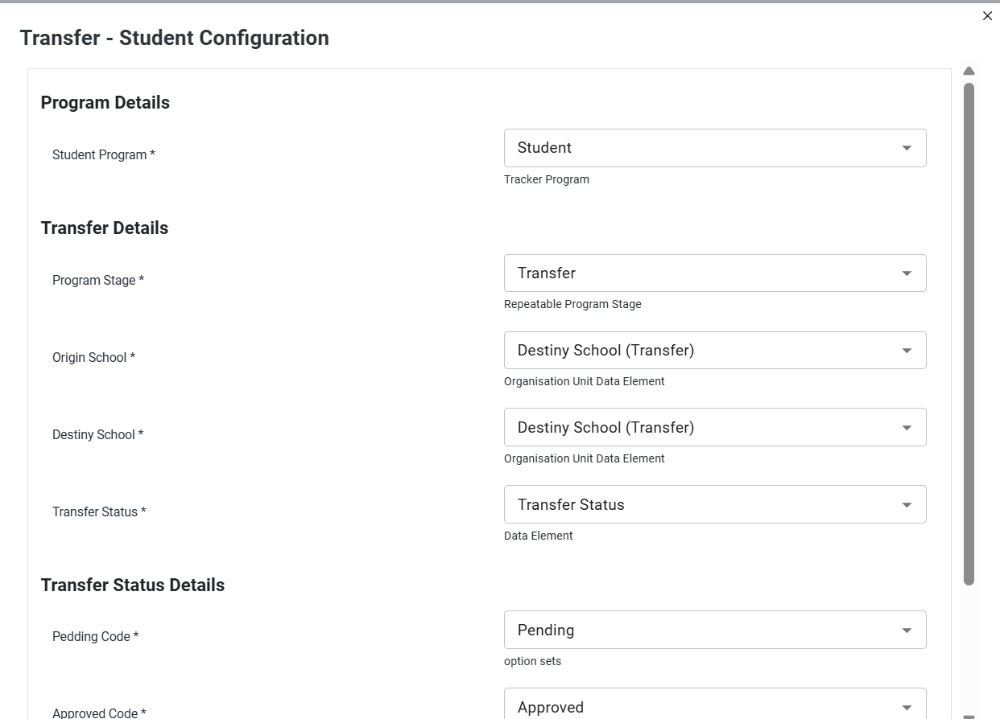

### Final result { #semis_config_final_result }

The Final Result module manages **student promotion, completion, or final academic outcomes** at the end of an academic period.

1. Configure program details (Select DHIS2 tracker-configured student program).
2. Configure promotable/re-enrollable status values under Promotion & Dropout Criteria and Dropout Status.
3. Configure Final Result details and
4. Click Submit

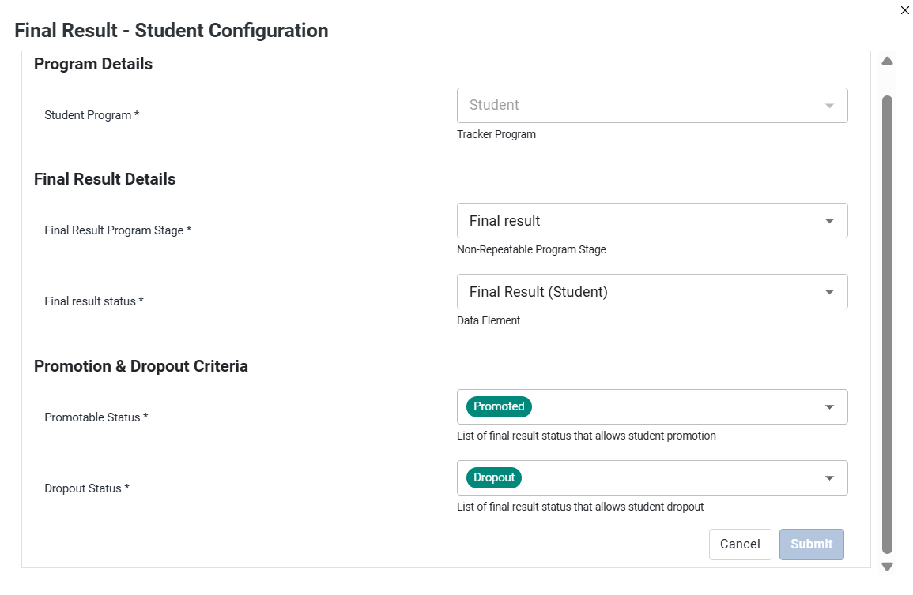

### Student profile { #semis_config_student_profile }

This Student Profile configuration screen controls how a student’s profile is presented - its identity details, summary indicators, and sections of information.

1. Configure the identity card

   * Click a highlighted area in the top card, such as Photo, First name Surname, Student System ID, or Gender. The screen instructions indicate that you can choose the area’s name, variables, and presentation.

   For example, configure the name area to display the student’s first name and surname, and the ID area to display the appropriate student identifier.

2. Check the academic year selector

   * The year tabs provide navigation between academic years, with more showing additional options. Check the profile using different years to verify which information changes with the selected year.

3. Configure summary cards

   * The screen supports a maximum of six indicators. Use these cards for key information that users need to see immediately, such as an attendance rate or average assessment score, where supported by the available indicators. Click a highlighted card to inspect its configuration. Give each card a clear label and select the intended indicator.

4. Organise profile sections

   * The screenshot shows a section named Performance.
   * Select + Add section to create another section.
   * Use the pencil beside a section name to edit it.
   * Use the bin icon to remove a section.
   * Possible sections could include Performance, Attendance, and Enrollment History, depending on the information the app supports.

5. Add components within a section

   * Select + Add component inside the chosen section. Configure the component using the options offered in the dialog. The component’s pencil and bin icons allow editing and removal.

Finally, verify the resulting student profile: check the displayed identity, indicator values, and components against a known student record, then switch academic years.

## Configure staff modules { #semis_config_configure_staff_modules }

The **Staff Configuration** section in the SEMIS application allows administrators to control how staff-related modules operate within the system. Through this configuration interface, administrators can enable, disable, or adjust different staff management modules to align with institutional workflows.

This configuration ensures that only the required staff management features are available to users and helps standardize staff-related processes across schools.

### Accessing staff configuration { #semis_config_accessing_staff_configuration }

To access the Staff Configuration settings:

1. Open the **SEMIS application** in DHIS2.
2. Navigate to **Configurations**.
3. Select the **Staff configuration page**.

The configuration page displays several **module icons** that represent different staff-related processes available in the system.

The Staff Configuration section is designed to **map and control staff workflows within the SEMIS application**.

Administrators can use this interface to:

* Configure how staff records are managed.
* Enable or disable staff-related modules.
* Control the visibility of staff workflow features.
* Customize the application based on administrative requirements.

This helps ensure that the system supports the staff lifecycle in a structured and controlled manner.

The Staff Configuration interface includes multiple modules that manage different aspects of staff administration.

### Staff registry { #semis_config_staff_registry }

The **Staff Registry** module allows administrators or authorized users to **register and maintain staff records** in the system.
 This includes basic staff information such as identity details, employment information, and institutional assignments.

1. Select and confirm the DHIS2 tracker configured for the STAFF program.
2. Specify Registration Details, e.g Type of staff, Type of staff filter name, Registration program stage (DHIS2 tracker configured), etc., and Socio-Economic details.
3. Specify default configurations and submit.
4. Fill in all mandatory fields, marked with \*

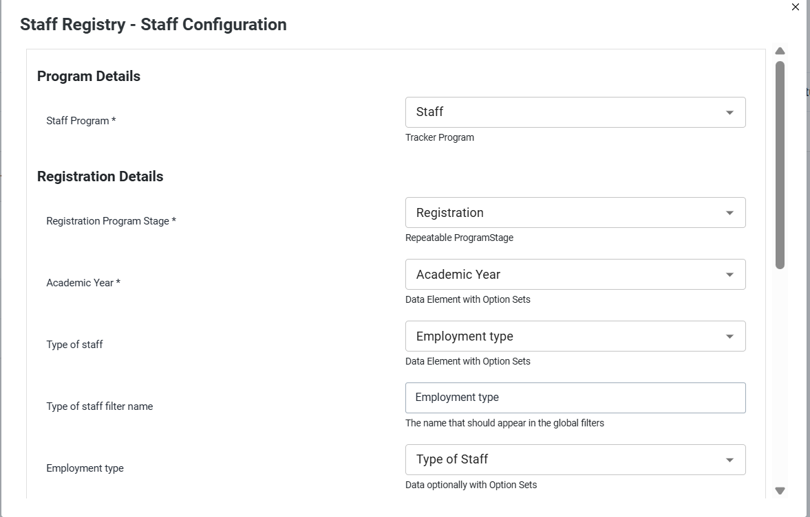

### Attendance { #semis_config_staff_attendance }

The **Attendance module** enables schools to **record and monitor staff attendance**.
 It allows institutions to track daily staff presence and maintain attendance records for administrative purposes.

1. Select and confirm the DHIS2 tracker configured for the STAFF program.
2. Configure attendance status details and general details e.g., program stage, attendance status (Present, Absent).
3. Configure class attendance (Optional)

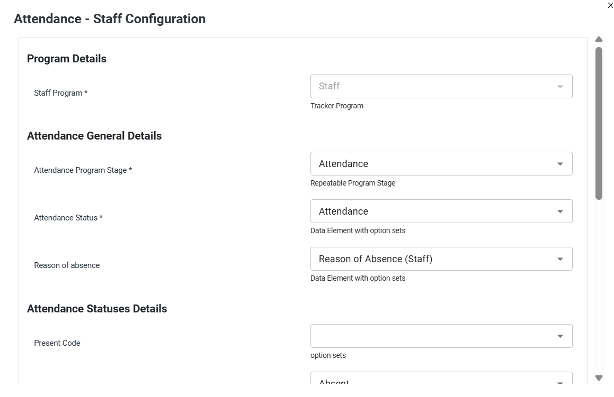

### Transfer { #semis_config_staff_transfer }

The **Transfer module** allows administrators to **manage staff movement between schools or institutions**.
 This ensures that staff records remain up to date when employees change their place of assignment.

1. Select and confirm the DHIS2 tracker configured for the STAFF program.
2. Confirm transfer request fields/status mapping
3. Confirm incoming/outgoing list behavior tied to configured status.
4. Confirm approval/rejection flow fields

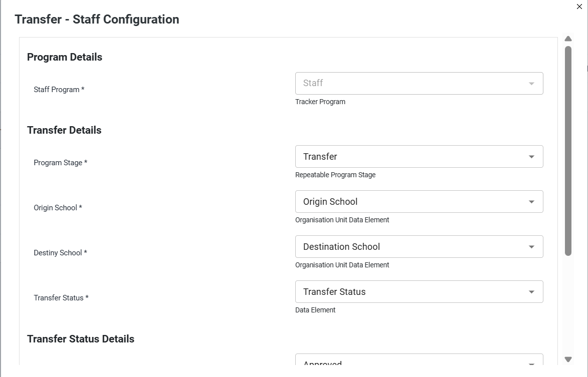

### Re-enroll { #semis_config_re_enroll }

The **Re-enroll module** allows administrators to **re-activate or re-enroll staff records** when necessary.
 This feature may be used when staff members return after a break in service or need to be reassigned within the system.

1. Select and confirm the DHIS2 tracker configured for the STAFF program.
2. Configure re-enrollable status values under Promotion & Dropout Criteria and Dropout Status.
3. Configure Final Result details as final status and click submit.

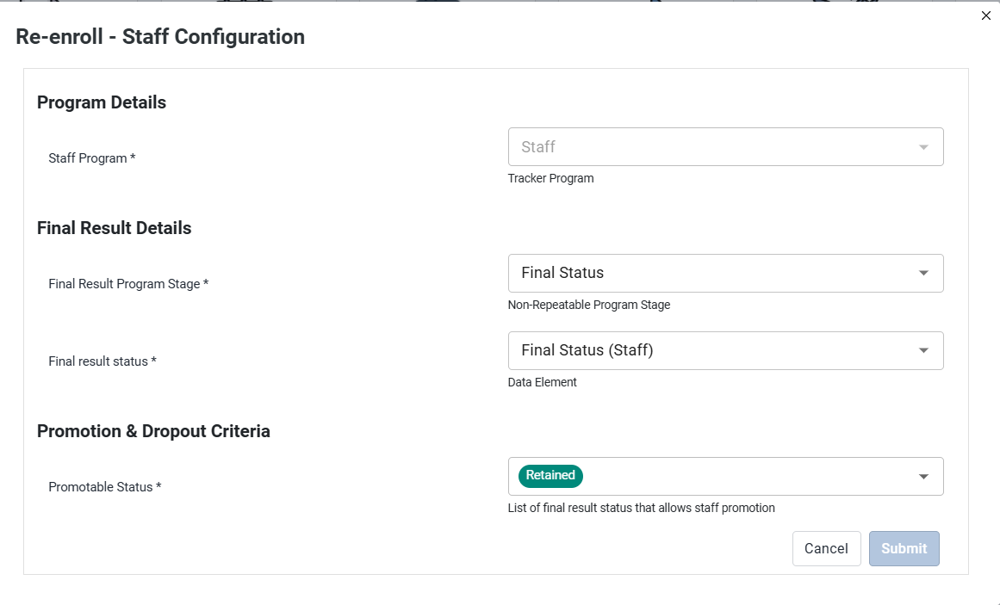

## Configuration dependencies { #semis_config_configuration_dependencies }

Several configuration components in SEMIS are interconnected. Changes or incomplete configuration in one area may affect the behavior of multiple modules across the system. Administrators should therefore ensure that foundational configurations are completed correctly before enabling related workflows.

Understanding these dependencies helps prevent system errors, incomplete data entry processes, and incorrect module behavior.

### School calendar dependency { #semis_config_school_calendar_dependency }

The **School Calendar configuration** must be properly defined before modules such as **Attendance** are used.

The calendar establishes:

* The **academic year**
* **School terms**
* **School operational days**
* **Non-school days or holidays**

Attendance recording relies on this configuration to determine valid attendance dates. If the school calendar is not configured correctly:

* Attendance entry may not be available.
* Attendance may appear disabled for certain dates.
* Reports may show incorrect attendance calculations.

Administrators should therefore verify that the academic year, terms, and school days are configured before testing or enabling the attendance module.

### Enrollment mapping dependency { #semis_config_enrollment_mapping_dependency }

The **Enrollment configuration** defines how students are registered and mapped within the system.

This configuration directly affects:

* **Student search functionality**
* **Student listing in different modules**
* **Student record updates**
* **Workflow navigation across modules**

If enrollment mapping is incomplete or incorrectly configured, users may experience issues such as:

* Students not appearing in search results
* Missing student records in attendance or performance modules
* Errors when updating student information

Ensuring correct enrollment configuration guarantees that student records flow correctly across all student-related modules.

### Final result configuration dependency { #semis_config_final_result_configuration_dependency }

The **Final Result configuration** determines how the system handles end-of-year academic outcomes for students.

This configuration affects the behavior of:

* **Promotion processes**
* **Completion status**
* **Final academic records**

Specifically, the configuration controls whether **Final Result action buttons** are enabled or disabled within the system interface.

If this configuration is missing or incorrect:

* The Final Result module may be unavailable.
* Result submission buttons may remain disabled.
* Students may not progress to the next academic level.

Administrators must ensure that final result statuses and related settings are properly configured before the end-of-year processing begins.

### Transfer configuration dependency { #semis_config_transfer_configuration_dependency }

The **Transfer configuration** manages how student or staff transfers are handled between schools or institutions.

This configuration defines:

* Transfer request workflows
* Approval requirements
* Movement of records between institutions

If the transfer configuration is incomplete or disabled:

* Transfer requests may not be generated.
* Approval workflows may not function correctly.
* Student or staff records may remain linked to the original institution.
* Proper transfer configuration ensures that records move accurately within the SEMIS system when individuals change institutions.
